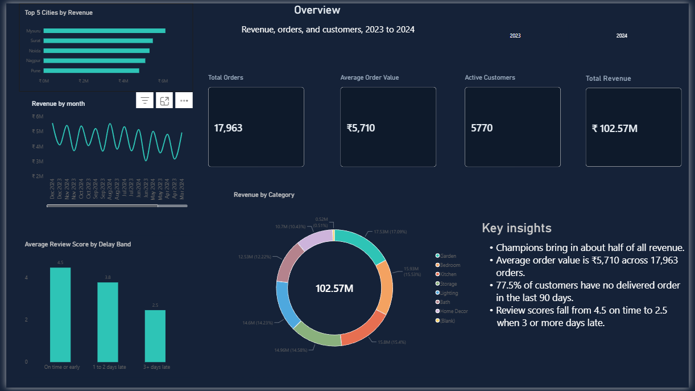
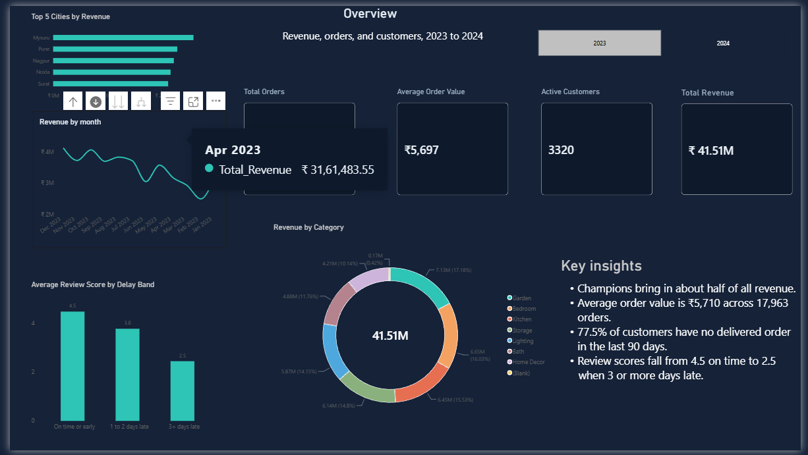
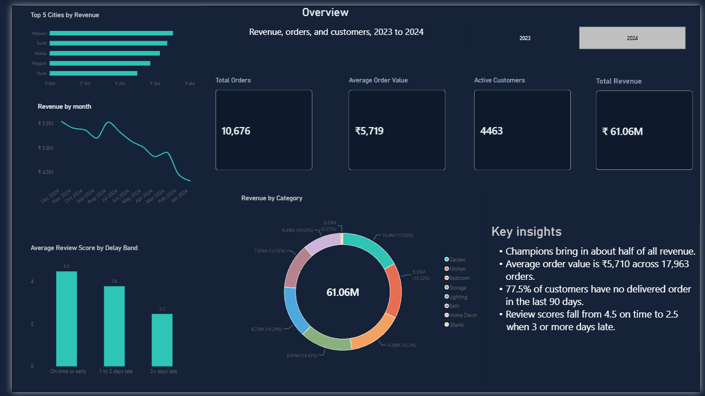

# E-Commerce Retention and Delivery Performance Analysis

An end-to-end analysis of a fictional Indian home-goods retailer, "Bharat Home," covering customer retention, churn, and delivery performance. Built with **SQL Server**, **Python** (pandas, Jupyter), and **Power BI**.

**Status:** Complete. Phases 1 to 5 are finished.




---

## Business Problem

The business needs to know which customers are at risk of leaving, which customer groups generate the most revenue, and whether late deliveries affect reviews.

**Key questions**
- Which customers are most valuable, and which are at risk?
- How many customers have stopped ordering (churn)?
- How does delivery performance vary by courier?
- Do late deliveries lower review scores?

**Scope**
- In scope: data cleaning, RFM segmentation, churn, delivery analysis, a multi-page dashboard
- Out of scope: predictive modelling, product recommendations

**Assumptions**
- Snapshot date: 1 January 2025
- Revenue counts delivered orders only
- Churn: a customer with no delivered order in the 90 days before the snapshot, or no delivered order at all

---

## Dataset

The data is **synthetic**, generated with a Python script. It covers orders from 1 January 2023 to 31 December 2024. No real customer or company data is used.

| Table | Raw rows | Description |
|---|---|---|
| customers | 8,080 | Customer details and signup date |
| products | 300 | Product name, category, brand, MRP |
| sellers | 40 | Seller details and rating |
| orders | 20,200 | Order date, status, channel |
| order_items | 40,012 | Products in each order, quantity, price |
| payments | 20,000 | Payment method and value |
| deliveries | 18,793 | Shipping and delivery dates, courier |
| reviews | 9,873 | Review score and comment |

The raw counts include deliberately planted duplicates and errors, so the cleaning step has real work to do.

---

## Phase 1: Requirements

Business questions, scope, and assumptions are listed above.

## Phase 2: Excel Cleaning

Power Query was used to explore and clean the eight tables in a separate workbook. The raw files were kept unchanged.

## Phase 3: SQL Server

**Database:** `EcomRetentionDB`

**Schemas**
- `raw`: all columns stored as text, loaded with `BULK INSERT`
- `clean`: typed and cleaned tables built with `SELECT ... INTO`
- `qa`: rejected rows and the cleaning log
- `mart`: views for Power BI

**Run order** (files in `sql/`)
1. `01_setup.sql`: create database and schemas
2. `02_create_raw_tables.sql`: raw tables
3. `03_load_raw.sql`: load the CSVs
4. `04_profiling.sql`: find data problems
5. `05_clean_tables.sql`: build clean tables
6. `06_qa_and_checks.sql`: rejected rows and integrity checks
7. `07_mart_views.sql`: mart views

### Cleaning summary

| Table | Issue | Rows | Action |
|---|---|---|---|
| customers | Duplicate rows | 80 | Removed (DISTINCT) |
| customers | Blank city | 240 (after dedupe) | Replaced with "Unknown" |
| customers | Blank pincode | 161 | Replaced with "Unknown" |
| products | Category in uppercase | 15 | Converted to Title Case |
| products | Trailing spaces in category | 9 | Trimmed |
| orders | Duplicate rows | 200 | Removed |
| orders | Mixed date formats | See data note | Converted with style 105 |
| order_items | Duplicate rows | 396 | Removed |
| order_items | Quantity 0 or negative | 607 (594 distinct) | Moved to `qa.rejected_order_items` |
| order_items | Orphan product_id (P9999) | 201 | Kept. Not labelled "Unknown" (no product view built) |
| payments | ₹ symbol and commas in value | 600 | Stripped, converted to decimal |
| deliveries | Delivered before shipped | 187 | Delivered date set to NULL, flagged (applied with UPDATE) |
| reviews | Score outside 1 to 5 | 49 | Moved to `qa.rejected_reviews` |
| sellers | Rating stored as text | n/a | Converted to decimal |

### Clean row counts

| Table | Rows |
|---|---|
| customers | 8,000 |
| products | 300 |
| sellers | 40 |
| orders | 20,000 |
| order_items | 39,022 |
| payments | 20,000 |
| deliveries | 18,793 |
| reviews | 9,824 |

### Integrity checks passed
- Every clean order has a matching customer (0 orphans).
- Every payment has a matching order (0 orphans).
- Every delivery has a matching order (0 orphans).
- Order items reconcile: 39,022 clean + 594 rejected = 39,616 distinct raw IDs.

### Mart views
- `mart.vw_order_revenue`: one row per delivered order, revenue summed from its items (17,963 rows).
- `mart.vw_delivery_performance`: one row per delivery, with delay days and an on-time flag (18,793 rows; 10,140 late).

### Data note: Excel re-save

The raw CSVs were re-saved from Excel at one point, which rewrote ISO dates (`2024-08-25`) as DD-MM-YYYY (`25-08-2024`). The mixed-format problem in the answer key could not be reproduced from these copies, so every date is converted with style 105. The counts in this README are measured on the Excel-saved data.

---

## Phase 4: Python RFM and Churn

**Notebook:** `notebooks/04_rfm_churn.ipynb`
**Output:** `notebooks/rfm_customers.csv` (8,000 rows, 10 columns)

**Method**
- Revenue is loaded from `mart.vw_order_revenue` through `pyodbc` and pandas.
- Orders with no valid items (129) keep their order, with revenue set to 0.
- Recency, frequency, and monetary are calculated per customer, against a snapshot date of 1 January 2025.
- R, F, and M are each scored 1 to 5 using quintiles. Frequency ties are broken by rank. Recency is reversed, so the most recent customers score highest.
- Customers with no delivered orders (2,230) get frequency 0 and are labelled "No delivered orders".

**Segment rules** (applied in this order)
1. No delivered orders: frequency 0
2. Champions: R, F, and M scores all 4 or higher
3. Loyal: F and R scores both 3 or higher
4. New: R score 4 or higher, and frequency 1
5. At Risk: R score 2 or lower, and F score 3 or higher
6. Lost: R score 2 or lower, and F score 2 or lower
7. Needs Attention: everyone else

**Segment counts**

| Segment | Customers |
|---|---|
| Champions | 776 |
| Loyal | 781 |
| New | 531 |
| Needs Attention | 1,374 |
| At Risk | 317 |
| Lost | 1,991 |
| No delivered orders | 2,230 |
| **Total** | **8,000** |

**Churn**
- Churned (1): 6,201 customers. Churn rate 77.5%.
- Not churned (0): 1,799 customers.
- The churn count differs by 28 customers from the expected figure calculated from the generator's files. The likely cause is the Excel re-save of mixed date formats, which may have shifted a few last-order dates. This was not corrected.

**Delivery and review findings**
- Average review score falls as delivery gets later: 4.48 when on time or early (4,561 reviews), 3.78 for 1 to 2 days late (3,351), and 2.47 for 3 or more days late (1,912).
- On-time rates by courier are similar, between 43% and 47%.

---

## Phase 5: Power BI Dashboard

**File:** `dashboard/EcomRetention_Dashboard.pbix` (PDF export in the same folder)

**Data model**
- Tables: `mart vw_order_revenue`, `mart vw_delivery_performance`, `clean customers`, `clean orders`, `clean order_items`, `clean products`, `clean reviews`, `rfm_customers`, and a `Date` table.
- The Date table covers 1 January 2023 to 31 December 2024 and links to the order date in the revenue view.

**Measures**
- Total Revenue, Total Orders, Active Customers, Average Order Value
- Churn Rate, On-Time Delivery %, Average Review Score
- Cancellation Rate, Return Rate
- Line Revenue (category revenue, with the delivered-only link applied in the model)

**Pages**
1. **Overview:** revenue, orders, average order value, and active customers, with a year slicer.
2. **Revenue and Customers:** revenue by segment, top 5 cities by revenue, and revenue by category.
3. **RFM and Churn:** segment summary, churn rate by segment, and the at-risk customer list. These show one snapshot as of 1 January 2025, so they do not follow the year slicer.
4. **Delivery and Reviews:** on-time rate by month and by courier, average delay by courier, and average review score by delay band.

**Key results**
- Total revenue: ₹102.57M from 17,963 delivered orders.
- Average order value: ₹5,710.
- Active customers: 5,770 of 8,000 customers have a delivered order.
- Churn rate: 77.5%, under the 90-day rule.
- On-time delivery: 45.5% of delivered orders arrived on or before the estimated date.
- Average review score: 3.85 out of 5. It falls from about 4.5 for on-time deliveries to about 2.5 for deliveries 3 or more days late.
- Cancellation rate: 6.0%. Return rate: 4.2%.

**Screenshots:** see `docs/` (`01_overview.png` to `04_delivery_reviews.png`).

---

## Folder Structure

```
main_project/
├── raw/            Source CSVs (unchanged)
├── clean/          Optional CSV exports
├── qa/             Cleaning log and rejected rows
├── mart/           Optional CSV exports of views
├── sql/            SQL scripts, run in numbered order
├── power_query/    Phase 2 Excel workbook
├── docs/           Screenshots
├── notebooks/      Phase 4 notebook and rfm_customers.csv
├── dashboard/      Phase 5 Power BI file and PDF export
└── README.md
```

## How to Reproduce

1. Use the CSV files in `raw/`, or regenerate them with the data script.
2. In SQL Server Management Studio, run `sql/01_setup.sql` through `sql/07_mart_views.sql` in order.
3. Update the file paths in `03_load_raw.sql` to your local `raw/` folder.
4. Open `notebooks/04_rfm_churn.ipynb` and run **Restart & Run All**. Update the connection string if your SQL Server instance differs.
5. Open `dashboard/EcomRetention_Dashboard.pbix` in Power BI Desktop and refresh the data. Connect the SQL Server sources to your local `EcomRetentionDB`.

## Tools

- SQL Server Express and SQL Server Management Studio (SSMS)
- Excel and Power Query
- Python with pandas, pyodbc, and Jupyter
- Power BI Desktop

---

*Author: Suyash Bhole*
